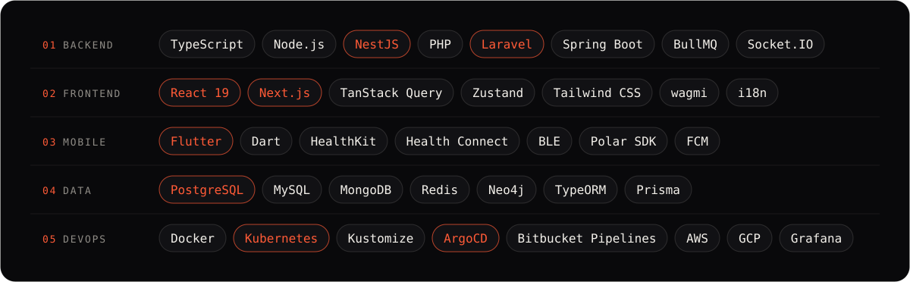

  

### Hi, I'm Phuong.

Full-stack developer in Ho Chi Minh City with four years of taking systems **from schema to production**: backend in **NestJS** and **Laravel**, frontend in **React 19** and **Next.js**, mobile in **Flutter** with smartwatch and Polar integrations, and delivery on **Kubernetes** with **ArgoCD**. Comfortable owning a system alone, and working in teams of up to twelve.

- Now — Full-Stack Developer at **Metagrit** (06/2025 – 10/2026)
- Before — Full-Stack Developer at **NhanhTravel** (07/2022 – 06/2025)
- B.Sc. Information Technology, Nguyen Tat Thanh University

### Highlights

| | |
| :-- | :-- |
| **15+ services** | Kubernetes/GitOps platform for a Web3 ecosystem — Kustomize overlays, ArgoCD applications and CI/CD for every repo |
| **Watch + Polar** | Two wearable health & fitness apps, Flutter + NestJS — HealthKit, Health Connect, BLE and the Polar SDK behind one device-agnostic data layer |
| **6 weeks** | Admin CMS from scratch for an AI astrology social app — rules engine, AI prompt management, SNS moderation, 3-language i18n |
| **700+ URLs** | PHP 7.4 → 8.2 upgrade of 4 production WordPress sites after a cluster security review — zero PHP errors in regression testing |
| **2.5 years** | B2B supplier portal owned solo — Laravel + Next.js, Excel/CSV bulk ingestion, near-real-time price sync via queues and webhooks |

### Stack

  

### Contact

Open to full-stack roles — reach me at **[thanhphuong2510.work@gmail.com](mailto:thanhphuong2510.work@gmail.com)**.

Most of my production work lives in private company repositories.
